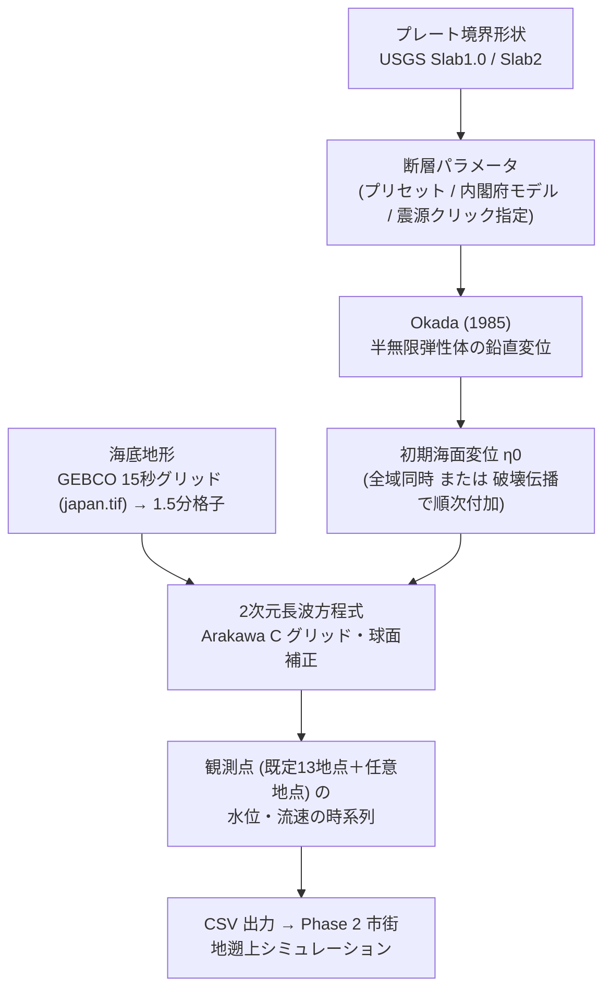

# 南海トラフ津波広域伝播シミュレーター 物理モデル解説書
**Physics Model Specification & Mathematical Formulations**

本書は、アプリに実装されている計算の内容（式・パラメータ・近似）を、実装に即して説明します。対応するソースコードを各節に示します（`nankai_trough/src/` 以下。デスクトップ版も同一）。

---

## 1. 計算の全体像

本システムは、2段階の津波シミュレーション（Phase 1: 広域伝播、Phase 2: 市街地遡上）のうち、**Phase 1** を担います。



| 項目 | 値 |
|---|---|
| 計算範囲 | 東経 125.600°〜152.925°、北緯 22.029°〜48.029°（日本全国） |
| 格子 | 経緯度 1.5分（0.025°）間隔、1093 × 1040 = 約114万セル |
| 格子間隔 | 南北 Δy = 2,775 m、東西 Δx = 1,862 m（北緯48°）〜 2,580 m（北緯22°） |
| 時間刻み | Δt = 3.0 s |
| 観測点の記録間隔 | 3.0 s（約4秒に最も近い時間刻みの整数倍） |

---

## 2. 波源（断層運動による海面変位）

### 2.1 断層パラメータ
（`src/types.ts` の `FaultParams`）

| 記号 | パラメータ | 単位 | 意味 |
|---|---|---|---|
| $L$ | 長さ | km | 走向方向の断層面の長さ |
| $W$ | 幅 | km | 傾斜方向に沿った断層面の幅 |
| $d_\text{top}$ | 上端深さ (`depthKm`) | km | 断層面の**上端**の深さ |
| $\theta$ | 走向 | ° | 北から時計回り。断層は走向の右手側へ傾斜して深くなる（Aki-Richards 規約） |
| $\delta$ | 傾斜 | ° | 水平面からの傾き |
| $\lambda$ | すべり角 | ° | 90°: 純粋な逆断層、0°: 左横ずれ |
| $D$ | すべり量 | m | 断層面上のすべりの大きさ（一様） |
| — | 基準点 (`epicenterLon/Lat`) | ° | 断層面の**地表投影の中心** |

すべりは走向成分 $U_1 = D\cos\lambda$、傾斜成分 $U_2 = D\sin\lambda$ に分けます。

### 2.2 Okada (1985) の鉛直変位
（`src/physics/okada.ts`）

地殻を半無限の均質弾性体（ポアソン比 $\nu = 0.25$、$\lambda = \mu$）とし、矩形断層による地表の鉛直変位 $u_z$ を Okada (1985) の解析解で求めます。

**座標系**: 原点を断層面の**下端**の端点に置き、$x$ を走向方向、$y$ を走向から反時計回りに90°の方向とします。断層面は $y$ の正の向きに浅くなります。下端の深さは $d = d_\text{top} + W\sin\delta$ です。

$$p = y\cos\delta + d\sin\delta,\qquad q = y\sin\delta - d\cos\delta$$

Chinnery の記法で4隅の寄与を合成します。

$$f(\xi,\eta)\,\| = f(x,p) - f(x,p-W) - f(x-L,p) + f(x-L,p-W)$$

$$u_z = -\frac{1}{2\pi}\Big[\,U_1\, f_\text{ss}(\xi,\eta)\,\| + U_2\, f_\text{ds}(\xi,\eta)\,\|\,\Big]$$

$$f_\text{ss} = \frac{\tilde{d}\,q}{R(R+\eta)} + \frac{q\sin\delta}{R+\eta} + I_4\sin\delta$$

$$f_\text{ds} = \frac{\tilde{d}\,q}{R(R+\xi)} + \sin\delta\,\arctan\frac{\xi\eta}{qR} - I_5\sin\delta\cos\delta$$

ここで

$$R = \sqrt{\xi^2+\eta^2+q^2},\quad \tilde{d} = \eta\sin\delta - q\cos\delta,\quad X = \sqrt{\xi^2+q^2},\quad \frac{\mu}{\lambda+\mu} = 1-2\nu = 0.5$$

$$I_4 = \frac{\mu}{\lambda+\mu}\,\frac{1}{\cos\delta}\Big[\ln(R+\tilde{d}) - \sin\delta\,\ln(R+\eta)\Big]$$

$$I_5 = \frac{\mu}{\lambda+\mu}\,\frac{2}{\cos\delta}\,\arctan\frac{\eta(X+q\cos\delta) + X(R+X)\sin\delta}{\xi(R+X)\cos\delta}$$

$\cos\delta = 0$（鉛直断層）では $I_4 = -\frac{\mu}{\lambda+\mu}\frac{q}{R+\tilde{d}}$、$I_5 = -\frac{\mu}{\lambda+\mu}\frac{\xi\sin\delta}{R+\tilde{d}}$ を用います。

**検証**: Okada (1985) の検算例（$x=2,\ y=3,\ d=4,\ \delta=70^\circ,\ L=3,\ W=2$、すべり1）に対し、走向すべり $u_z = -2.747\times10^{-3}$、傾斜すべり $u_z = -3.564\times10^{-2}$ を得ており、文献値と4桁一致します。

**数値上の保護**: 対数・分母の特異点を避けるため $R+\eta,\ R+\xi,\ R+\tilde{d}$ に下限 $10^{-9}$ を設け、$|u_z|$ は $1.5D$ を上限とします。

> [!NOTE]
> 2026年10月の改修より前の実装は、Okada の式と異なる式を用いており、深さの扱いも誤っていた（断層面の上端が地表より上に出る設定になっていた）ため、正しい変位を与えていませんでした。改修により、既存プリセットの計算結果も変わっています（例: 南海トラフ全域連動 M9.1 の室戸岬沖の最大波高 3.2 m → 4.1 m）。

### 2.3 格子への展開と打ち切り
各断層について、基準点を中心に東西・南北の距離 $(X, Y)$ [m] を求め、断層座標に回転します（$k_\text{lon} = 111{,}132\cos\varphi_0$ m/度、$k_\text{lat} = 111{,}132$ m/度）。

$$x = X\sin\theta + Y\cos\theta + \tfrac{L}{2},\qquad y = -X\cos\theta + Y\sin\theta + \tfrac{W}{2}\cos\delta$$

計算量を抑えるため、基準点から半径 $R_s = 1.2(L+W)$ の範囲だけを計算し、外側30%には打ち切りの段差が生じないようコサイン型の重みを掛けます。

$$w(r) = \begin{cases}1 & r \le 0.7R_s\\[2pt] \tfrac12\left[1+\cos\dfrac{\pi(r-0.7R_s)}{0.3R_s}\right] & 0.7R_s < r < R_s\\[2pt] 0 & r \ge R_s\end{cases}$$

複数の断層の変位は線形に足し合わせます: $\eta_0 = \sum_k w_k\,u_z^{(k)}$。

### 2.4 海面への与え方
（`src/physics/shallowWater.ts` の `resetWithDisplacement`）

* 断層運動は津波の周期（数十分）より十分短いため、海底の鉛直変位がそのまま海面に現れるとします（Kajiura, 1963 の長波近似。水深による平滑化は行いません）。
* 水深 $h > 5$ m のセルにだけ与え、陸のセルの隆起・沈降は水位に反映しません。
* **全域同時破壊**（プリセット・震源クリック指定）: 時刻0に $\eta(x,y,0) = \eta_0(x,y)$。
* **破壊伝播**（内閣府モデル）: 破壊開始点からの地表距離 $r$ を破壊伝播速度 $V_r = 2.5$ km/s で割った時刻から、ライズタイム $T_r = 60$ s をかけて線形に変位を加えます。

$$\eta_\text{src}(x,y,t) = \eta_0(x,y)\cdot\min\!\left(1,\ \max\!\left(0,\ \frac{t - r/V_r}{T_r}\right)\right)$$

  各時間ステップの最初に、$t \to t+\Delta t$ の間の増分を水位に加えます。破壊開始点の深さは距離に含めていません。

---

## 3. 断層モデルの作り方

### 3.1 プリセット
（`src/data/presets.ts`）

| シナリオ | 断層 | 主な値 | 備考 |
|---|---|---|---|
| 南海トラフ全域連動 (M9.1) | 4枚 | 東海 L140×W70km・14m、東南海 160×85km・18m、南海 200×90km・20m、日向灘 120×65km・10m、傾斜12〜18° | 簡易モデル。内閣府の公式モデルではない |
| 東南海地震単独 (M8.2) | 1枚 | 180×80km、9.5m、走向245°、傾斜15° | 1944年型。震源（気象庁）が断層内にある |
| 南海地震単独 (M8.4) | 1枚 | 中心 134.5°E 32.75°N、270×90km、9.0m、走向250°、傾斜12° | 1946年型。震源（135.85°E 32.94°N）が東端に入るよう配置。地震モーメントは旧設定（220km、11m）と同じ |
| 東海地震単独 (M8.0) | 1枚 | 130×65km、7.0m、走向230°、傾斜18° | 想定地震 |
| 2011年 東北地方太平洋沖地震 (M9.0) | 4枚 | 宮城沖海溝寄り 180×70km・30m（上端1km）、宮城沖深部 200×80km・12m（上端15km）、岩手沖 150×80km・20m、福島・茨城沖 180×80km・8m | 簡略モデル。下表の GPS 波浪計と比較して調整 |

**2011年東北地方太平洋沖地震の再現性**（地震後2時間の計算、各地点の最大水位）

| 地点 | モデル | 観測（GPS波浪計） |
|---|---|---|
| 宮城中部沖 | 6.4 m（地震後28分） | 5.7 m |
| 宮城北部沖 | 5.3 m | 5.6 m |
| 岩手南部沖（釜石沖） | 4.4 m | 6.7 m |
| 岩手中部沖（宮古沖） | 4.0 m | 6.3 m |

宮城沖はよく合いますが、岩手沖は過小です（4枚の断層による簡略化の限界）。

### 3.2 内閣府 南海トラフ巨大地震モデル（ケース①〜⑤）の概略再現
（`src/data/cabinetOfficeNankai.ts`）

内閣府「南海トラフの巨大地震モデル検討会」第二次報告（2012）の津波断層モデルを、報告書本文の設定ルールから再構成します（公式の約5kmメッシュの小断層データは申請制のため使っていません）。

**(1) 形状**: 海底地形から読み取ったトラフ軸（駿河湾奥 138.62°E 35.05°N 〜 日向灘 132.0°E 30.85°N の折れ線）を約25kmごとに区切り、各区間から陸側（走向の右手）へ次の帯を置きます。駿河湾内（北緯34.3°以北・東経138.2°以東）はプレートが急に深くなるため、帯の水平幅を半分にします。

| 帯 | トラフ軸からの水平距離 | プレート境界の深さ | 役割 |
|---|---|---|---|
| T1 | 0〜22 km | 2〜5.5 km | トラフ沿い（超大すべり域になりうる浅い段） |
| T2 | 22〜45 km | 5.5〜10 km | トラフ沿い（主部断層側の段） |
| B | 45〜95 km | 10〜20 km | 主部断層の浅い側（大すべり域になりうる） |
| C | 95〜140 km | 20〜30 km | 主部断層（背景） |
| D | 140〜172 km | 30〜37 km | 主部断層の最深部 |

**(2) すべり量**（報告書のルールに対応）
* 主部断層（B・C・D）の平均すべり量 $\bar{D}_m = 10$ m。
* 大すべり域: 全体面積の20%を、トラフ軸から深さ20kmまで（T1・T2・B）の矩形として、指定した位置に置く。B のすべり $2\bar{D}_m = 20$ m。
* 超大すべり域: 大すべり域内のトラフ沿い。T1 が $4\bar{D}_m = 40$ m、T2 が中間値 30 m（駿河湾内はいずれも 20 m）。
* 大すべり域の外のトラフ沿い（T1・T2）は 0 m。
* 最深部 D は背景の 0.85 倍（報告書の「最深の段 1/4、次の段 1/2」を帯全体で平均した値）。
* 背景すべり量 $b$ は、主部断層の地震モーメントが $\bar{D}_m \times$（主部断層面積）になるよう決めます。

$$b = \frac{\bar{D}_m S_\text{main} - 2\bar{D}_m S_{B,\text{large}}}{S_{B,\text{bg}} + S_C + 0.85\,S_D}\ \approx 8.9\text{ m}$$

* 大すべり域の境界をまたぐ区間は、重なる長さの割合で按分します。

**(3) 規模**: 剛性率 $\mu = \rho V_s^2$（$\rho = 2.8$ g/cm³、$V_s = 3.82$ km/s、報告書と同じ）、$\log_{10}M_0 = 1.5M_w + 9.1$。

| | 本モデル | 内閣府（公式） |
|---|---|---|
| 面積 | 13.9万 km² | 14万 km² |
| $M_w$ | 9.1 | 9.1 |
| 平均すべり量 | 10.1〜10.7 m | 10.3〜10.9 m |
| 最大すべり量 | 40 m | 約 40 m |

**(4) 破壊開始点**: 大すべり域の中心に最も近い区間の、帯 B と C の境界（深さ20km）。破壊伝播は 2.4節のとおり。

**(5) 公式モデルとの違い**: プレート形状を一様な傾斜の帯で近似、すべりのプレート沈み込み速度比例配分と大すべり域境界の平滑化は省略、ケース⑥〜⑪（分岐断層・大すべり域2箇所）は未実装。

### 3.3 震源クリック指定（プレート境界に沿った自動設定）
（`src/data/slab.ts`、`scripts/process_slab.py`）

**(1) プレート境界形状**: USGS Slab1.0（Hayes et al., 2012）の kur（千島・日本海溝）、izu（伊豆・小笠原）、ryu（南海トラフ・琉球）の深さグリッドを 0.1° 格子に変換します（Slab2 の深さグリッドにも対応）。走向・傾斜は深さ $z$（km、下向き正）の勾配から求めます。

$$\delta = \arctan|\nabla z|,\qquad \phi_\text{dip} = \operatorname{atan2}\!\left(\frac{\partial z}{\partial x_E},\ \frac{\partial z}{\partial x_N}\right),\qquad \theta = \phi_\text{dip} - 90^\circ$$

  複数のスラブが重なる場所では、最も浅いもの（上盤側のプレート境界）を採用します。

**(2) 断層の大きさ**: プレート間地震のスケーリング則（Strasser et al., 2010）

$$\log_{10}L = -2.477 + 0.585M_w,\qquad \log_{10}W = -0.882 + 0.351M_w\quad[\text{km}]$$

  例: $M_w$ 8.0 → 160 × 84 km、9.0 → 614 × 189 km。

**(3) すべり量**: $D = M_0/(\mu L W)$、$\mu = 40$ GPa。

**(4) 配置**: クリック地点を断層の地表投影の中心とし、その地点のプレート境界の深さ $z_c$・走向・傾斜を用います（すべり角 90°）。上端深さ $d_\text{top} = z_c - \frac{W}{2}\sin\delta$ が 1 km 未満になる場合は、上端が 1 km になるまで断層を傾斜方向（陸側）へ $\frac{(1-d_\text{top})\cos\delta}{\sin\delta}$ km ずらします。

**(5) 自動設定しない場合**: データ範囲外、$z_c > 60$ km、または自動設定オフのときは、画面の手動パラメータ（走向・傾斜・すべり角・上端深さ）と (2)(3) の大きさ・すべり量を用います。

---

## 4. 津波の伝播（長波方程式）

### 4.1 基礎方程式
（`src/physics/shallowWater.ts` の `step`）

水位変動 $\eta$、静水深 $h$、全水深 $D = h + \eta$、線流量 $M = uD$（東向き）、$N$（格子では南向き正）を未知数とします。

**連続の式**（球面座標。$\varphi$: 緯度、$a$: 地球半径）

$$\frac{\partial\eta}{\partial t} + \frac{1}{a\cos\varphi}\left[\frac{\partial M}{\partial\lambda} + \frac{\partial (N\cos\varphi)}{\partial\varphi}\right] = 0$$

**運動方程式**

$$\frac{\partial M}{\partial t} + gD\frac{\partial\eta}{\partial x} + \frac{g n^2}{D^{7/3}}M\sqrt{M^2+N^2} = 0,\qquad \frac{\partial N}{\partial t} + gD\frac{\partial\eta}{\partial y} + \frac{g n^2}{D^{7/3}}N\sqrt{M^2+N^2} = 0$$

* $g = 9.80665$ m/s²、Manning の粗度係数 $n = 0.025$ s/m^{1/3}。
* 圧力勾配項と摩擦項に全水深 $D = h+\eta$ を用いるため波の振幅の効果を含みますが、**移流項（$\partial(M^2/D)/\partial x$ など）とコリオリ力は含みません**。また、長波近似のため波の分散性は扱いません。

### 4.2 長波の伝播速度と浅水変形
長波の伝播速度は $c = \sqrt{gh}$ です。

| 海域 | 水深 $h$ | 速度 $c$ | 時速 |
|---|---|---|---|
| 伊豆・小笠原海溝（計算範囲の最深部） | 9,835 m | 311 m/s | 約 1,120 km/h |
| 日本海溝・南海トラフ周辺の深海 | 4,000〜6,000 m | 200〜240 m/s | 約 710〜870 km/h |
| 大陸棚斜面 | 200 m | 44 m/s | 約 160 km/h |
| 沿岸 | 10 m | 9.9 m/s | 約 36 km/h |

水深が浅くなると波高は増し、摩擦と反射を無視すると Green の法則 $H \propto h^{-1/4}$ に従います（水深 4,000 m で 1 m の波は、水深 10 m で約 4.5 m）。本システムの観測点は水深数十〜数千 m の沖合にあり、海岸での波高はこれより大きくなります。

---

## 5. 数値計算法

### 5.1 格子配置（Arakawa C グリッド）

```
                 N[c, r-1]
                     |
--- M[c-1, r] --- η[c, r], h[c, r] --- M[c, r] ---
                     |
                  N[c, r]
```

* セル中心: 水位 $\eta$、水深 $h$
* 東側の境界: $M[c,r]$（セル $c$ と $c+1$ の間）
* 南側の境界: $N[c,r]$（行 $r$ と $r+1$ の間。行番号は南向きに増える）

### 5.2 球面補正
計算範囲が南北26°に及ぶため、東西の格子間隔を行ごとに変えます（`dxRow`）。

$$\Delta x_r = \Delta\lambda \cdot 111{,}320\cos\varphi_r\ [\text{m}],\qquad \Delta y = 2{,}775\ \text{m}$$

連続の式の南北フラックスには、境界の緯度での $\cos\varphi$ を重みとして掛けます。

$$\eta^{n+1}_{c,r} = \eta^n_{c,r} - \Delta t\left[\frac{M_{c,r} - M_{c-1,r}}{\Delta x_r} + \frac{N_{c,r}\dfrac{\cos\varphi_{r+1/2}}{\cos\varphi_r} - N_{c,r-1}\dfrac{\cos\varphi_{r-1/2}}{\cos\varphi_r}}{\Delta y}\right]$$

### 5.3 時間積分
各ステップで、(0) 破壊伝播による変位の付加 → (1) 運動方程式で $M, N$ を更新（$\eta^n$ を使用）→ (2) 更新後の $M, N$ で連続の式から $\eta^{n+1}$ を求める（前進・後退型のスタガード時間積分）→ (3) 平滑化フィルター → (4) 外洋境界、の順に計算します。

**摩擦の半陰解法**: 浅い所で摩擦項による発散を防ぐため、摩擦を分母に置きます。

$$M^{n+1} = \frac{M^n - gD\,\dfrac{\eta^n_{c+1}-\eta^n_c}{\Delta x_r}\,\Delta t}{1 + \dfrac{g n^2\sqrt{M^2+\bar{N}^2}}{\max(1,D)^{7/3}}\,\Delta t}$$

$D$ と $\bar N$ はフラックス位置への平均値です（$D$ は下限 0.1 m）。

### 5.4 時間刻み（CFL条件）

$$\Delta t \le \frac{\min(\Delta x_r, \Delta y)}{\sqrt{2}\,\sqrt{g h_\text{max}}}$$

最小の格子間隔 $\Delta x = 1{,}862$ m（北緯48°）、最大水深 $h_\text{max} = 9{,}835$ m（$c_\text{max} = 311$ m/s）より $\Delta t_\text{CFL} = 4.24$ s。指定値 $\Delta t = 3.0$ s はその 0.9 倍以内なのでそのまま使います（クーラン数 約0.71）。超える場合は $0.8\,\Delta t_\text{CFL}$ に自動で下げます。

### 5.5 計算領域の絞り込み（アクティブ領域）
波の存在しうる範囲（初期変位のある矩形から、1ステップごとに3セルずつ拡大）だけを計算します。CFL 条件により波は1ステップで1セル未満しか進まないため、全域を計算した場合と**結果は完全に一致**します（確認済み）。計算時間は 2 時間分で約1分です。

---

## 6. 境界条件と数値安定化

### 6.1 外洋境界（放射境界）
計算範囲の外周の水位を、内側のセルの値から外向きに透過させて、境界での反射を抑えます。

$$\eta_\text{境界} = \eta_\text{内側}\cdot\exp\left(-\frac{\sqrt{g h}\,\Delta t}{\Delta x}\right)$$

### 6.2 陸の境界と引き波の制限
* 水深 $h \le 1$ m のセルを陸とし、その境界の流量を $M = N = 0$ にします（海岸で完全反射。陸への遡上は計算しません）。
* 強い引き波で全水深が負にならないよう、$\eta < -h$ になったら $\eta = -0.95h$ にします。

### 6.3 平滑化フィルター
急な海底斜面で生じる格子規模の振動（波長 $2\Delta x$）を抑えるため、毎ステップ、海のセルに弱いラプラシアン平滑化を掛けます。

$$\eta \leftarrow \eta + \kappa\cdot\frac{1}{K}\sum_{k=1}^{K}\left(\eta_k - \eta\right),\qquad \kappa = 0.03$$

（$K$ は水深 1 m を超える隣接セルの数、最大4）

**長い波への影響**: 一方向に進む波長 $\Lambda$ の波は、1ステップごとに振幅が $G = 1 - \frac{\kappa}{2}\left(1-\cos\frac{2\pi\Delta}{\Lambda}\right)$ 倍になります（$\Delta \approx 2.5$ km）。

| 波長 $\Lambda$ | 20分後（400ステップ） | 2時間後（2,400ステップ） |
|---|---|---|
| 5 km（$2\Delta$、格子ノイズ） | ほぼ 0 | 0 |
| 40 km | 63 % | 6 % |
| 100 km | 93 % | 64 % |
| 200 km | 98 % | 90 % |

浅い海では津波の波長が数十 km まで短くなるため、このフィルターは沖合の観測点の最大波高を**無視できない程度に下げます**。フィルターあり（κ = 0.03）となし（κ = 0）で2時間計算した最大水位の比較（2026年10月時点の実装）:

| シナリオ | 地点 | κ = 0.03 | κ = 0 | 差 |
|---|---|---|---|---|
| 2011年東北 | 岩手北部沖 | 3.08 m | 5.27 m | −42 % |
| | 釜石沖 | 4.35 m | 4.98 m | −13 % |
| | 宮城北部沖 | 5.26 m | 5.67 m | −7 % |
| | 宮城中部沖 | 6.44 m | 7.19 m | −10 % |
| 内閣府 ケース④ | 足摺岬沖 | 5.21 m | 6.69 m | −22 % |
| | 室戸岬沖 | 3.50 m | 4.09 m | −14 % |
| | 日向灘沖 | 2.29 m | 2.70 m | −15 % |
| | 潮岬沖 | 3.01 m | 3.08 m | −2 % |

到達時刻はほとんど変わりません。κ = 0 でも2時間の計算は安定していましたが、観測点の波形に格子規模の振動が出ないかは別途確認が必要です。本書の 3.1 節の再現性の比較は κ = 0.03 での値です。

> [!IMPORTANT]
> 旧版の本書では「主峰波高の減衰は0.1%未満」としていましたが、上の計算のとおりこれは正しくありません。

### 6.4 観測点の値
（`sampleSinglePoint`）

* 観測点を囲む4セルのうち海のセル（$h > 1$ m）だけで双線形補間し、重みを正規化します。周囲に海のセルがない場合は最も近いセルの値を使います。
* 流速は $u = M/D$、$v = -N/D$（北向き正に変換）。流向は $\operatorname{atan2}(u, v)$（北0°、時計回り）。
* **スパイクの平滑化**: 直前の記録から 0.3 m を超えて変化した場合、その記録を直近3回の重み付き平均 $0.45\eta_t + 0.35\eta_{t-1} + 0.2\eta_{t-2}$ に置き換えます。CSV に出力される水位にも適用されます。
* **統計値**: 第1波到達は $|\eta| \ge 0.15$ m になった最初の時刻、最大波高はその地点の最大水位、波侵入方向は最大水位を記録したときの流向です。震源域の上や近くの地点では、全域同時破壊の地殻変動そのもので到達時刻が 0 秒になります。

---

## 7. Phase 2 との連携（CSV）

| 列 | 内容 |
|---|---|
| `Time_sec` | 全期間データ: 地震発生からの時間。市街地連携用: 第1波到達の2分前を0とした時間 |
| `Elevation_m` | 水位変動（上昇が正） |
| `U_velocity_m_s` / `V_velocity_m_s` | 東向き・北向きの水深平均流速 |
| `Speed_m_s` / `Direction_deg` | 流速の大きさと流向（北0°、時計回り） |
| `Time_since_EQ_sec` / `Time_since_EQ_hms` | 市街地連携用のみ。地震発生からの時間 |

記録間隔は 3 秒です。市街地モデルの沖合境界では、水位と流速をどちらも**与えられた時系列の値**（ディリクレ型の境界値）として用いることを想定しています。市街地連携用データの切り出し範囲は、第1波到達の2分前から「最大波の35分後」と「第1波到達の45分後」の遅い方までです。

---

## 8. 主な近似と限界

| 項目 | 内容 | 影響 |
|---|---|---|
| 格子 | 約2.8 km | 湾・港・狭い海峡の地形は表現できない |
| 方程式 | 移流項・コリオリ力・分散性なし | 浅海での非線形効果、遠地での波形の分散は再現しない |
| 陸 | 遡上を計算しない（海岸で反射） | 海岸での津波高・浸水は Phase 2 で扱う |
| 波源 | 一様すべりの矩形（の組み合わせ）、水深による平滑化なし | 短い波長の成分がやや強く出る |
| 平滑化フィルター | κ = 0.03 を毎ステップ | 浅海の短い波長の波を減衰させる（6.3節） |
| 観測点の記録 | 0.3 m を超える急変を平滑化 | 急激な水位変化をなまらせる |
| 内閣府モデル | 公表ルールからの概略再現 | 公式の波高とは一致しない |

---

## 9. 参考文献

1. Okada, Y. (1985). Surface deformation due to shear and tensile faults in a half-space. *Bull. Seismol. Soc. Am.*, 75(4), 1135-1154.
2. Kajiura, K. (1963). The leading wave of a tsunami. *Bull. Earthq. Res. Inst., Univ. Tokyo*, 41, 545-571.
3. Arakawa, A., & Lamb, V. R. (1977). Computational design of the basic dynamical processes of the UCLA general circulation model. *Methods in Computational Physics*, 17, 173-265.
4. Hayes, G. P., Wald, D. J., & Johnson, R. L. (2012). Slab1.0: A three-dimensional model of global subduction zone geometries. *J. Geophys. Res.*, 117, B01302.
5. Hayes, G. P., et al. (2018). Slab2, a comprehensive subduction zone geometry model. *Science*, 362, 58-61.
6. Strasser, F. O., Arango, M. C., & Bommer, J. J. (2010). Scaling of the source dimensions of interface and intraslab subduction-zone earthquakes with moment magnitude. *Seismol. Res. Lett.*, 81(6), 941-950.
7. 内閣府（防災担当）(2012). 南海トラフの巨大地震モデル検討会 第二次報告 津波断層モデル編.
8. 気象庁. 震源データ（1944年昭和東南海地震、1946年昭和南海地震、2011年東北地方太平洋沖地震）.
9. GEBCO Compilation Group. GEBCO 15 arc-second grid（`japan.tif` として切り出し）.
